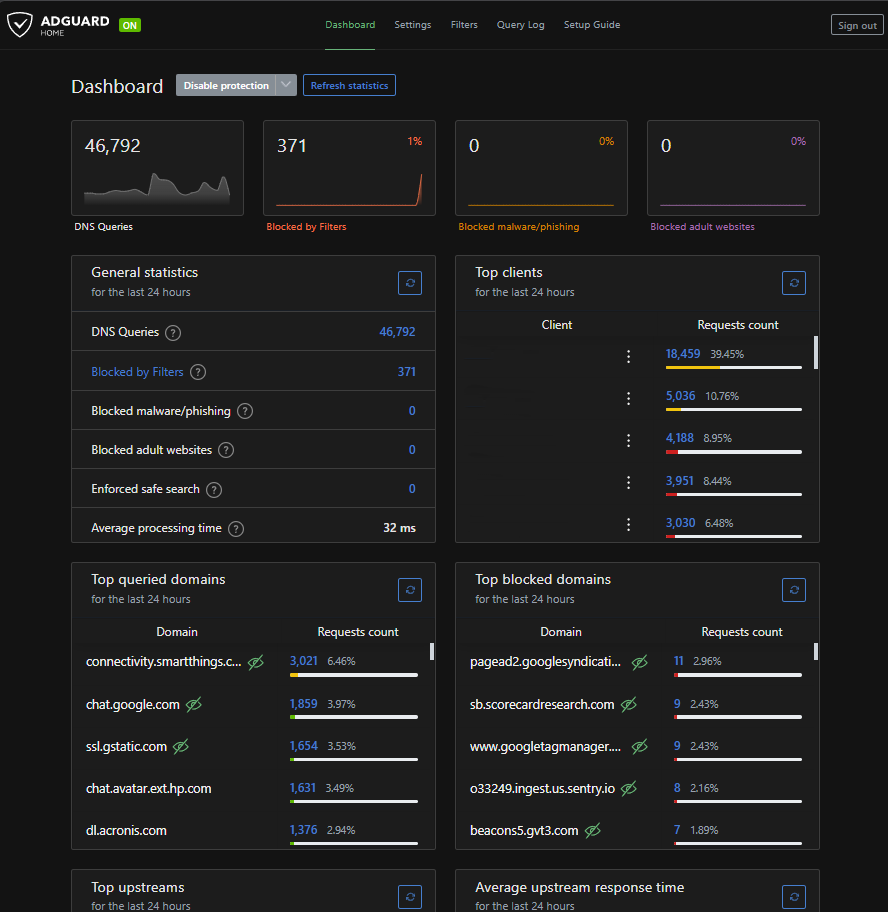
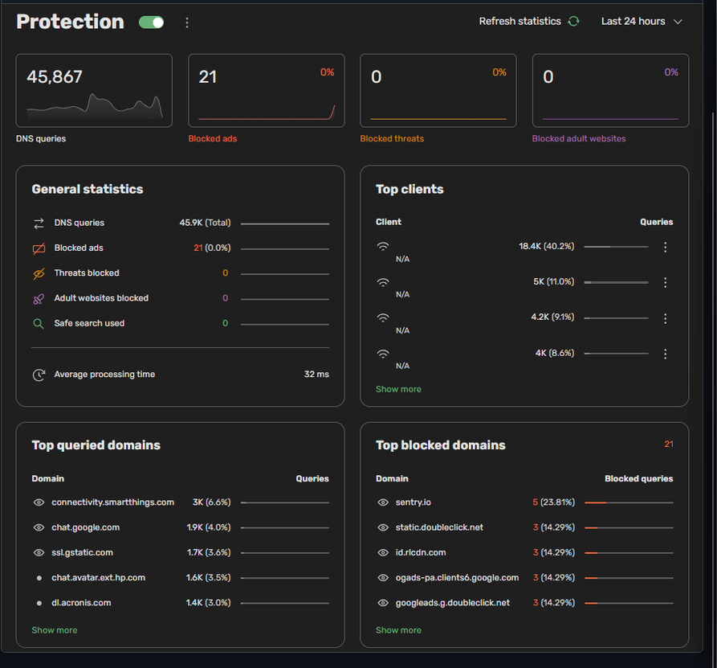

# AdGuard Home v1.0 Beta Migration

**AdGuard Home · Debian LXC · Proxmox · DNS · Recovery and validation**

## Why I made the change

I upgraded my AdGuard Home instance from `v0.107.79` to `v1.0.0-b.1` to evaluate the new 1.0 beta. The service ran in a Debian LXC under Proxmox and provided DNS filtering for my home network.

The goal was to move to the new release while retaining the existing DNS configuration, filtering rules, administrator account, and query history. Because other devices depended on this service, recovery was part of the plan from the beginning.

## Preparing for recovery

Before making changes, I created a Proxmox snapshot of the container and confirmed the installed version and application location. That snapshot captured the working service and its data together, giving me a way to restore the container if the upgrade failed.

I also made an application-level backup, but stored it inside the application directory. That placement became a problem during the first attempt.

## What went wrong

My first approach used the AdGuard Home installer in reinstall mode to switch to the beta channel. In this attempt, the installer stopped and removed the existing service and application directory before downloading the replacement.

I had launched the installer from inside that same directory. Once it was removed, the download failed with a write error, leaving AdGuard Home unavailable. The backup stored inside the directory was removed as well.

I restored the Proxmox snapshot, then checked the original version, service status, and DNS functionality. The rollback returned the service to its working state.

For the second attempt, I ran the installer from a temporary directory. This avoided the download problem and installed the beta, but the application opened as a fresh installation: the existing configuration was missing, the interface requested a new administrator account, and DNS was not responding.

I rolled back again. Changing the working directory had addressed the first failure, but the reinstall approach still did not preserve the configuration I needed.

## How I completed the upgrade

I changed the scope of the upgrade to replacing only the AdGuard Home executable.

After downloading and checking the beta binary, I stopped the service, replaced the executable in the existing installation, restored its executable permissions, and started the service again. I left the configuration and data directories in place.

This time, the beta loaded the existing configuration and historical data. The narrower change preserved the state that the reinstall attempts had removed.

## How I validated the result

I checked the running version and service status, then tested DNS resolution directly against the server. I also checked that filtering and protection remained enabled and that the configured filter update interval was retained.

In the application, I verified the existing administrator account, DNS settings, blocklists, client statistics, and query history. These checks covered both the DNS service that devices relied on and the configuration and history I wanted to preserve.

## Before and after

<table>
  <tr>
    <th>Before — v0.107.79</th>
    <th>After — v1.0.0-b.1</th>
  </tr>
  <tr>
    <td align="center" valign="top">
      
    </td>
    <td align="center" valign="top">
      
    </td>
  </tr>
</table>

The screenshots show the interface before and after the migration. The displayed totals reflect different observation times; they are not a performance comparison.

## Outcome and lessons

The migration finished with AdGuard Home `v1.0.0-b.1` running in the existing container, with DNS functionality restored and the original configuration and historical data retained.

The two failed attempts made the recovery plan as important as the upgrade itself. The snapshot provided a working rollback path, while the failures showed why I needed to understand what the installer would replace before using it on a service with persistent state.

For future changes, I would keep application backups outside any directory the installer might remove, choose an upgrade method that preserves the required data, and validate the underlying service as well as its interface.

[← Local Control, Segmentation, and Automation](evolution/09-local-control.md) · [Home Lab Portfolio](../README.md)
