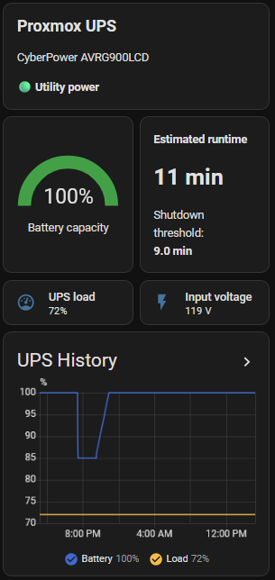

# CyberPower UPS Monitoring Recovery on Proxmox

**CyberPower AVRG900LCD · PowerPanel Linux · NUT · Proxmox · Home Assistant**

## Why I added UPS monitoring

I wanted the homelab to recognize a power outage, show useful battery information, and give me warning before Proxmox needed to shut down. I initially had CyberPower PowerPanel Linux 1.4.2 working with my AVRG900LCD over USB. PowerPanel's `pwrstatd` daemon supplied the monitoring on the Proxmox host, while Home Assistant provided the UPS dashboard and notifications.

That first working setup established that the UPS could provide live telemetry. The harder part was getting back to that state after a reboot during kernel work left monitoring broken.

## What failed after the reboot

The UPS was still physically connected, but a visible USB device did not mean that an application could initialize its HID interface and keep reading data. I explored NUT 2.8.1 with its `usbhid-ups` driver while trying to recover monitoring.

The troubleshooting covered USB access, HID descriptor failures, driver-to-server communication, and service supervision. Several changes produced a promising intermediate result without restoring reliable monitoring. I had to stop treating a successful service start or one retrieved descriptor as proof that the complete path worked.

## The troubleshooting trail

These were the main tests and what I learned from them, rather than a claim that any one hardware change fixed the problem.

| Test or change | What it established |
| --- | --- |
| NUT 2.8.1 `usbhid-ups` testing, including a root-run debug test | HID initialization could still fail; the final permissions message alone did not explain the failure. |
| Different physical USB ports | Results varied. A port that retrieved a descriptor once was not necessarily reliable under continued polling. |
| Anker USB hub test | Another USB path to test, but it did not establish a lasting recovery. |
| Kernel upgrade from `7.0.2-6-pve` to `7.0.14-23-pve` | A kernel change was part of the investigation; it was not sufficient evidence that a kernel regression caused the incident. |
| UPS restart | Tested whether resetting the UPS changed communication behavior; it was not the final fix by itself. |
| NUT socket ownership and polling changes | Exposed separate communication layers, but did not resolve the underlying HID failures. |
| Process and systemd inspection | Revealed that PowerPanel and a leftover, supervised NUT driver were both running. This changed the recovery approach. |

Representative inspection commands were:

```bash
uname -r
lsusb -d 0764:0501
lsusb -t
sudo journalctl -k -b --no-pager
ps -eo user,pid,ppid,args | grep -E '[p]wrstatd|[u]sbhid-ups'
systemctl list-units 'nut-driver*' --all --no-pager
```

The USB vendor/product ID identified this UPS during troubleshooting. Bus numbers, device numbers, and HID node names describe an observed connection and should not be assumed to remain fixed.

## Why the permissions errors sent me in circles

One recurring NUT message was:

```text
libusb1: Could not open any HID devices: insufficient permissions on everything
No matching HID UPS found
```

It sounded like a straightforward Unix permissions problem. However, the HID descriptor failures during initialization were a different layer of the problem, and root-run tests did not turn them into reliable telemetry. The last summary line was not enough to diagnose the cause.

I also encountered a real socket-access problem between NUT's driver and its information server. These are selected lines from the troubleshooting capture, with timestamps and process prefixes omitted:

```text
Can't connect to UPS [cyberpower] (usbhid-ups-cyberpower): Permission denied
Connected to UPS [cyberpower]: usbhid-ups-cyberpower
Data for UPS [cyberpower] is stale - check driver
```

Changing the driver socket from `root:root` to `root:nut` allowed the server to reach it, but the client still reported:

```text
Init SSL without certificate database
Error: Data stale
```

That distinction mattered. Fixing socket access did not prove that the driver was still receiving fresh data from the UPS. Likewise, increasing `pollinterval` and `pollfreq` could not fix a driver that failed immediately during initialization.

A representative manual NUT diagnostic was:

```bash
sudo timeout 15s /usr/lib/nut/usbhid-ups -a cyberpower -DDD
```

This belongs to the troubleshooting stage, with other UPS readers stopped. It is not part of the recovered PowerPanel configuration. I do not have a complete verbatim descriptor-error trace reproduced here; the excerpts above preserve the available log wording rather than reconstructing missing output.

## The turning point: finding the actual NUT service

When I returned to PowerPanel, process inspection showed both `pwrstatd` and a leftover `usbhid-ups` process. What looked like an orphaned driver was still being managed by systemd. Stopping the NUT information server alone did not stop its USB driver.

The generated driver instance was:

```text
nut-driver@MD5_c553abd116dd657242e0fcb31e7a6af7.service
```

I had already masked the readable `nut-driver@cyberpower.service` name, but that was not the instance actually running. The enumerator log made the mismatch explicit:

```text
Failed to enable unit: Unit /etc/systemd/system/nut-driver@cyberpower.service is masked
Enabled instance: 'nut-driver@MD5_c553abd116dd657242e0fcb31e7a6af7' for NUT configuration section 'cyberpower'
Started instance: 'nut-driver@MD5_c553abd116dd657242e0fcb31e7a6af7' for NUT configuration section 'cyberpower'
```

This explained why stopping or masking the assumed name had not removed the competing reader. The useful check was the actual process and its owning unit, not the name I expected from `ups.conf`.

## How I restored PowerPanel monitoring

I stopped PowerPanel while clearing the competing driver, then stopped and masked the exact generated NUT instance:

```bash
sudo systemctl stop pwrstatd.service
sudo systemctl mask --now nut-driver@MD5_c553abd116dd657242e0fcb31e7a6af7.service
sudo systemctl reset-failed nut-driver@MD5_c553abd116dd657242e0fcb31e7a6af7.service
ps -eo user,pid,ppid,args | grep -E '[p]wrstatd|[u]sbhid-ups'
```

The checksum-based unit name above is specific to this installation. On another host I would discover the active instance first rather than copy it blindly.

With the userspace readers stopped, I disconnected and reconnected the UPS USB cable. The kernel's `hid-generic` driver recreated `hiddev0` and `hidraw0` cleanly. I then started PowerPanel alone and checked its output:

```bash
sudo journalctl -k -b --no-pager
sudo systemctl start pwrstatd.service
sudo pwrstat -status
ps -eo user,pid,ppid,args | grep -E '[p]wrstatd|[u]sbhid-ups'
```

PowerPanel returned to **Normal** status with live telemetry. The recovered arrangement had one userspace UPS reader: PowerPanel. The clean HID reattachment and removal of the competing NUT driver were the decisive recovery steps in this incident. They do not prove that every earlier descriptor failure had the same cause.

## Home Assistant and service cleanup

With host-side telemetry restored, the Home Assistant UPS dashboard and notifications had useful data again. I kept the shutdown-imminent warning based on estimated remaining runtime, with a nine-minute threshold, rather than replacing it with a fixed battery percentage. The useful runtime at a given percentage can change as the lab's load changes.

I also changed estimated shutdown times in the outage and shutdown-imminent notifications to 24-hour format:

```jinja2
{{ (now() + timedelta(minutes=minutes_left)).strftime('%H:%M') }}
```

Beszel still showed failed systemd services after communication recovered. The captured check confirmed that, after masking and clearing the driver failure, `nut-monitor.service` remained failed:

```text
UNIT                LOAD   ACTIVE SUB    DESCRIPTION
nut-monitor.service loaded failed failed Network UPS Tools - power device monitor and …
```

Because this setup had returned to PowerPanel, the remaining cleanup was to disable the unused NUT monitor and clear its recorded failure:

```bash
sudo systemctl disable --now nut-monitor.service
sudo systemctl reset-failed nut-monitor.service
systemctl --failed --no-pager
```

Clearing a failed state does not repair USB communication or start a service. It addresses the monitoring warning after the unwanted service has been retired. The available capture ends before the final failed-unit check, so I do not present an empty failure list as a recorded result.

## The recovered UPS dashboard

<p align="center">
  <a href="../images/cyberpower-ups-dashboard.png">
    
  </a>
</p>

<p align="center"><em>The Home Assistant UPS dashboard after recovery, showing live status and telemetry alongside the runtime-based shutdown threshold and history.</em></p>

## Outcome and lessons

I recovered stable **Normal** status and live UPS telemetry through PowerPanel after removing the competing NUT driver and reconnecting USB cleanly. Home Assistant remained the dashboard and notification layer.

The most useful lessons were:

- **Check who owns the device.** Before changing permissions or kernels, inspect all running UPS readers and the services supervising them.
- **Discover generated unit names.** Masking `nut-driver@cyberpower.service` did not stop the checksum-named instance actually running.
- **Separate the failure layers.** USB enumeration, HID initialization, driver socket access, fresh telemetry, and dashboard updates each need their own evidence.
- **Treat partial success cautiously.** An active service, one successful descriptor read, or a connected socket did not establish sustained monitoring.
- **Keep changes attributable.** Port changes, a hub, a UPS restart, and a kernel upgrade were useful experiments, but none justified a hardware or kernel root-cause claim on its own.
- **Validate after reboot.** The original installation worked before a reboot exposed the problem. Another reboot check and a controlled outage/shutdown test remain useful follow-up validation; restored telemetry alone does not establish either result.

[← Evolution index](evolution/README.md) · [HomeLab Portfolio](../README.md)
